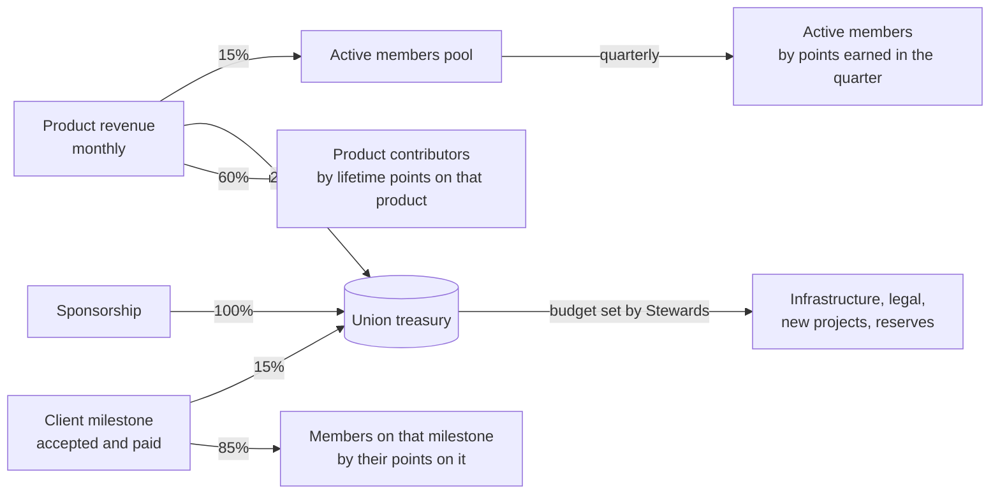
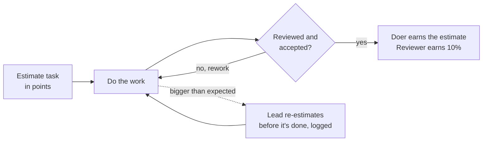
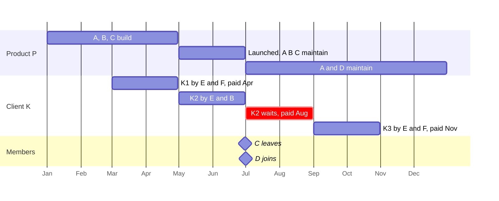

# Payouts: points and revenue sharing

*v0.1 proposal, for discussion. Values marked **[placeholder]** are set by vote. It builds on the [Economic model](model.md) and doesn't change its splits.*

This proposal answers one question: **who gets how much of the money the Union earns.** It covers how work is measured (points), how product and client revenue are shared, and how the active members pool is paid. Expenses and debts are left out on purpose and will get their own proposal (see [Not covered here](#not-covered-here)).

## In short
- Work is measured in **points**. Before work starts, the team estimates every task in points. When the task is accepted, whoever did it earns **the estimate, not the hours they spent.**
- Your share of anything is **your points ÷ everyone's points** on that thing.
- **Co-op products** pay out every month: **60%** to the product's contributors by their lifetime points on it, **25%** to the treasury, and **15%** to the active members pool. That's 12:5:3 **[placeholder]**, the same as the [Economic model](model.md).
- **Client work** pays out when the client accepts and pays a milestone: **85%** to the members who did it, by their points on that milestone, and **15%** to the treasury. That's 17:3 **[placeholder]**.
- **The active members pool** is paid **once a quarter**, by the points each member earned in that quarter, across all products, client work and commons work.
- **Sponsorship** goes 100% to the treasury. The Stewards set the budget.
- **Leaving** keeps your product contributor share forever. You stop getting pool payouts once you stop contributing.



## 1. Points
A point is a unit of agreed work. To calibrate, **1 point ≈ 1 hour of focused work by an experienced engineer [placeholder]**. Products and client work use the same scale, because both feed the same pool.

**How points are earned:**
1. **Estimate first.** Before a product or client contract starts, the team breaks it into milestones and tasks and estimates each task in points. The estimate is public.
2. **Earn on acceptance.** A task's points go to whoever did it once it's reviewed and merged, or once the milestone is accepted. A fast member earns the same points in less time. A slow member doesn't earn more.
3. **Re-estimate in the open.** If a task turns out bigger than expected, the Project Lead re-estimates it *before* it's finished, and the change is logged with a reason. Re-estimating after the fact isn't allowed.
4. **Reviews earn points.** The reviewer of an accepted task earns **10% [placeholder]** of its points, on top of the doer's points.
5. **Unplanned work** like urgent bugs, ops and support can be logged at **1 point per hour [placeholder]**, approved by the Lead, up to **20 points per member per month [placeholder]**.
6. **Commons work counts too:** governance, Steward duties, mentoring, docs and sales. It's estimated as tasks the same way and approved by a Lead or Steward. It earns pool points but no product contributor share.

Leads can't approve their own points. Any member can challenge a points entry within **14 days [placeholder]**, the same as for [reputation](../governance/reputation.md). Points for revenue are a separate ledger from reputation points for voting.



<!-- sim:tasks -->
### How points are earned

| Task | Estimate | Hours spent | Points to doer | Points to reviewer |
|---|---:|---:|---:|---:|
| Signup flow | 20 | 18 | C: 20 | A: 2 |
| Billing integration | 40 → 50 | 52 | B: 50 | A: 5 |
| Landing page | 10 | 16 | A: 10 | C: 1 |
| Fix login bug (unplanned) | — (1 pt/hour) | 3 | B: 3 | — |

Totals: A 17, B 53, C 21
<!-- /sim:tasks -->

A spent 16 hours on a 10-point task and earns 10. B's billing task was re-estimated from 40 to 50 before it was finished, so B earns 50. A and C earn review points on each other's work.

## 2. Co-op products
Every month, for each product:

```
contributors_share  = 60% × revenue
member_i gets         contributors_share × lifetime_points_i ÷ lifetime_points_all   (on that product)
treasury            += 25% × revenue
pool                += 15% × revenue
```

- **Lifetime points** are all accepted points on that product since it started, including maintenance after launch.
- New contributors dilute existing ones gradually. Nobody's points are ever taken away.
- **Members who leave keep their contributor share** for as long as the product earns ("earned stays earned", [Charter](../../CHARTER.md) 2.4).
- Revenue here means gross revenue. How product expenses and treasury loans come out first is for the expenses proposal.

## 3. Client work
For each milestone, when the client accepts it **and pays**:

```
member_i gets  85% × fee × points_i_on_milestone ÷ points_all_on_milestone
treasury      += 15% × fee
```

- Payouts follow the money in. A milestone that's delivered but not yet accepted or paid pays nothing yet.
- Rework the client asks for is done within the agreed points, unless the Lead re-estimated before delivery. This is the same rule as for products.
- Client points also count toward the active members pool, in the month the work is accepted internally.

## 4. Active members pool
The pool collects **15%** of every product's revenue each month. At the end of each calendar quarter (Mar, Jun, Sep and Dec) it's paid out in full:

```
member_i gets  pool × quarter_points_i ÷ quarter_points_all
```

- **Quarter points** are all points a member earned in the quarter: product, client and commons work.
- A calendar quarter is close to the Charter's **Active** window ("contributed in the last 90 days [placeholder]"). Active status itself doesn't change. The pool just pays for points earned in the quarter, so if you earned none this quarter, your share is zero.
- **Members who stop contributing stop receiving pool payouts.** They keep their product contributor share (section 2).
- Points earned before a member leaves still count in that quarter's round.
- If nobody earned points in a quarter, the pool goes to the treasury.

Why quarterly: payments are larger and fewer, the books are simpler, and a quarter roughly matches the 90-day Active window.

## 5. Sponsorship
Sponsorship money goes **100% to the treasury**. The Stewards decide how it's spent under a published budget, as in the [Economic model](model.md).

## 6. Before a product starts
A product proposal that reaches the Planning stage (see [Proposal lifecycle](../governance/proposal-lifecycle.md)) publishes:
- **The estimate:** milestones and tasks, with points, and the total.
- **The team:** roles and skills needed, and who has committed.
- **Expected expenses:** hosting, tools, services. How these are funded is for the expenses proposal.
- **The revenue path:** pricing, and when first revenue is expected.

If accepted points go over the total estimate by more than **25% [placeholder]**, the team publishes a new estimate and the backers re-confirm before work continues.

## Worked example
A fictional year with one product, one client contract and one sponsor. The tables below are generated by [`sim/payouts.py`](sim/payouts.py), which checks every month that money in equals money paid out plus the treasury and the pool. Run `python3 docs/economics/sim/payouts.py` to reproduce them. To try other numbers, change the scenario in the script and run it with `--update-doc`.

**The setup:**
- **Product P:** A, B and C build it from January to April. It launches in May. Revenue is €800 in May and €1,500 in June, then grows €1,000 a month to €7,500 in December. **C leaves the Union at the end of June.** **D joins in July** and maintains it.
- **Client contract K:** three milestones, €12,000 each, 150 points each. E and F deliver K1 (paid April). E and B deliver K2 in May–June, but the client asks for changes and **accepts and pays only in August**. E and F deliver K3 (paid November).
- **Commons:** F serves as a Steward and earns 10 points a month.
- **Sponsor:** €500 a month from March.



<!-- sim:example -->
### Product P: lifetime points and contributor shares

|  | A | B | C | D | Total |
|---|---:|---:|---:|---:|---:|
| End of Apr | 480 (40.0%) | 400 (33.3%) | 320 (26.7%) | 0 (0.0%) | 1200 |
| End of Jun | 560 (40.6%) | 440 (31.9%) | 380 (27.5%) | 0 (0.0%) | 1380 |
| End of Dec | 800 (40.4%) | 440 (22.2%) | 380 (19.2%) | 360 (18.2%) | 1980 |

### Money flow per month

| Month | P revenue | → contributors 60% | → treasury 25% | → pool 15% | Client paid | → members 85% | → treasury 15% | Sponsor | Pool paid out | Treasury balance |
|---|---:|---:|---:|---:|---:|---:|---:|---:|---:|---:|
| Jan | — | — | — | — | — | — | — | — | — | — |
| Feb | — | — | — | — | — | — | — | — | — | — |
| Mar | — | — | — | — | — | — | — | €500 | — | €500 |
| Apr | — | — | — | — | €12,000 | €10,200 | €1,800 | €500 | — | €2,800 |
| May | €800 | €480 | €200 | €120 | — | — | — | €500 | — | €3,500 |
| Jun | €1,500 | €900 | €375 | €225 | — | — | — | €500 | €345 | €4,375 |
| Jul | €2,500 | €1,500 | €625 | €375 | — | — | — | €500 | — | €5,500 |
| Aug | €3,500 | €2,100 | €875 | €525 | €12,000 | €10,200 | €1,800 | €500 | — | €8,675 |
| Sep | €4,500 | €2,700 | €1,125 | €675 | — | — | — | €500 | €1,575 | €10,300 |
| Oct | €5,500 | €3,300 | €1,375 | €825 | — | — | — | €500 | — | €12,175 |
| Nov | €6,500 | €3,900 | €1,625 | €975 | €12,000 | €10,200 | €1,800 | €500 | — | €16,100 |
| Dec | €7,500 | €4,500 | €1,875 | €1,125 | — | — | — | €500 | €2,925 | €18,475 |
| **Year** | €32,300 | €19,380 | €8,075 | €4,845 | €36,000 | €30,600 | €5,400 | €5,000 | €4,845 | **€18,475** |

### Quarterly pool rounds

| Quarter | Pool | Points | A | B | C | D | E | F |
|---|---:|---:|---:|---:|---:|---:|---:|---:|
| Q1 | — | 1005 | 360 pts → — | 300 pts → — | 240 pts → — | — | 50 pts → — | 55 pts → — |
| Q2 | €345 | 735 | 200 pts → €93.88 | 200 pts → €93.88 | 140 pts → €65.71 | — | 140 pts → €65.71 | 55 pts → €25.82 |
| Q3 | €1,575 | 405 | 120 pts → €466.67 | — | — | 180 pts → €700 | 40 pts → €155.55 | 65 pts → €252.78 |
| Q4 | €2,925 | 405 | 120 pts → €866.67 | — | — | 180 pts → €1,300 | 40 pts → €288.89 | 65 pts → €469.44 |

### What each member received in the year

| Member | Product P (60%) | Client K (85%) | Pool (15%) | Total |
|---|---:|---:|---:|---:|
| A | €7,839.91 | — | €1,427.22 | **€9,267.13** |
| B | €4,909.64 | €4,080 | €93.88 | **€9,083.52** |
| C | €4,235.39 | — | €65.71 | **€4,301.10** |
| D | €2,395.06 | — | €2,000 | **€4,395.06** |
| E | — | €18,360 | €510.15 | **€18,870.15** |
| F | — | €8,160 | €748.04 | **€8,908.04** |
| **All** | €19,380 | €30,600 | €4,845 | **€54,825** |

### Monthly income per member

| Month | A | B | C | D | E | F |
|---|---:|---:|---:|---:|---:|---:|
| Jan | — | — | — | — | — | — |
| Feb | — | — | — | — | — | — |
| Mar | — | — | — | — | — | — |
| Apr | — | — | — | — | €6,800 | €3,400 |
| May | €193.49 | €156.28 | €130.23 | — | — | — |
| Jun | €459.10 | €380.84 | €313.53 | — | €65.71 | €25.82 |
| Jul | €608.11 | €445.95 | €385.13 | €60.81 | — | — |
| Aug | €850.63 | €4,664.81 | €505.06 | €159.50 | €6,120 | — |
| Sep | €1,559.53 | €707.14 | €610.71 | €989.29 | €155.55 | €252.78 |
| Oct | €1,334.83 | €815.73 | €704.50 | €444.94 | — | — |
| Nov | €1,576.59 | €912.77 | €788.30 | €622.34 | €5,440 | €4,760 |
| Dec | €2,684.85 | €1,000 | €863.64 | €2,118.18 | €288.89 | €469.44 |
<!-- /sim:example -->

**What the example shows:**
- **No revenue, no pool.** The Q1 pool is empty because P wasn't selling yet. Points still count toward lifetime shares.
- **Leavers keep earning from what they built.** C left in June and still gets 19.2% of P's contributor share in December (€863.64). C gets nothing from the Q3 and Q4 pools.
- **Late joiners catch up through work.** D joined in July with zero points. By December D holds 18.2% of P, and with the most points in Q3 and Q4, D gets the largest pool payouts.
- **Client work pays early. Products pay over time.** In year one, client work pays far more per point: about €70 per point, against about €10 per point on P so far. But A's income from P grows every month and keeps going for as long as P sells, while a client contract pays once.
- **Delays move money, not shares.** K2 was delivered in June and paid in August. B and E got exactly their share, just later.
- **The treasury grows from three streams:** 25% of products, 15% of client work and all sponsorship. That's €18,475 by December.

## Not covered here
Each of these is a separate decision:
- **Expenses and debts:** how product and client expenses are paid, whether the treasury lends to products, and whether loans are repaid before payouts.
- **Point decay:** whether old points count less in the contributor share over time.
- **Early-risk bonus:** whether points earned before a product has any revenue count extra, e.g. ×2.
- **Taxes and payment mechanics:** these depend on the [legal entity](legal-entity-options.md).

If this proposal is adopted, [Economic model](model.md) section 1 links here for "split by contribution", and the contribution question in [Open questions](../open-questions.md) is closed.
